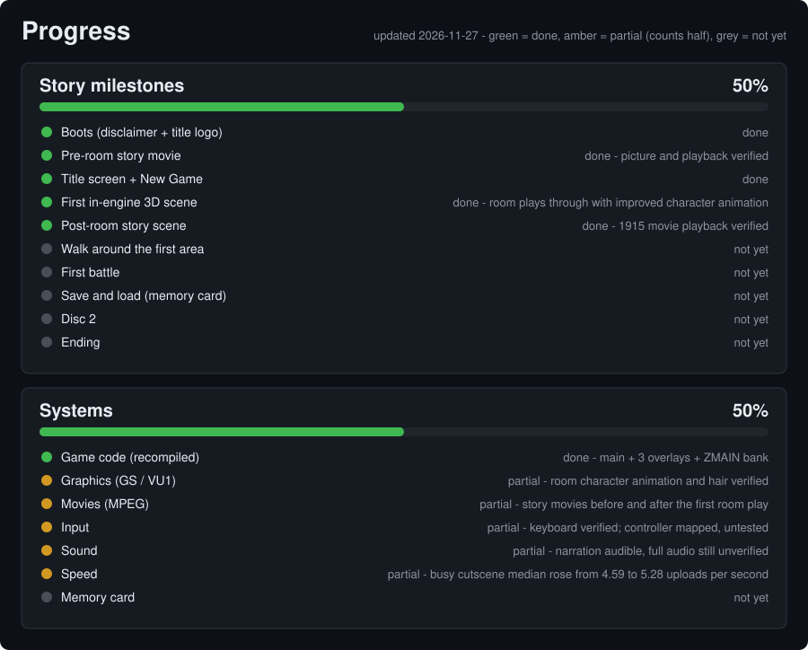

# Shadow Hearts: Covenant — native PC port (work in progress)

An experiment in running **Shadow Hearts: Covenant** (PS2, USA, `SLUS_210.41`) natively on Windows
by **static recompilation** of the game's MIPS (R5900) code to C++, using
[PS2Recomp](https://github.com/ran-j/PS2Recomp).

> **This repository contains no game code or data.** You must own the game and dump your own disc.
> Everything derived from the disc — the executable, overlays, IRX modules, PKB archives and the
> recompiled C++ — stays on your machine and is excluded by `.gitignore`.

## Status



The chart is drawn from `docs/status.json` by `scripts/progress.py`. Details of every fix are in
[`docs/progress.md`](docs/progress.md), and the technical background is in
[`docs/findings.md`](docs/findings.md).

## Repository layout

```
config/            PS2Recomp configs (main executable, extra entries, 3 overlays)
patches/           Patch for PS2Recomp (base commit e563698): runtime + IOP fixes and the
                   Shadow Hearts game override
scripts/           Pipeline scripts (Python 3; `pip install rabbitizer`)
scripts/research/  One-off analysis helpers kept for reference
docs/              Findings and progress log
screenshots/
```

## Building (outline)

Full step-by-step notes are in `docs/build.md`. In short:

1. Dump your disc to an ISO and extract its files.
2. `scripts/main2elf.py` → re-sectioned `MAIN.elf`; `scripts/addctors.py` → constructor entry points.
3. `scripts/ovl2elf.py` for `OPENING.BIN`, `FIELD.BIN` and `BATTLE.BIN`, then `scripts/ovlentries.py`.
4. Clone PS2Recomp at commit `e563698` and `git apply patches/ps2recomp-e563698-shadow-hearts.patch`.
5. Run `ps2_analyzer` and `ps2_recomp` with the configs in `config/`.
6. `scripts/ovlbank.py` turns each overlay output (and the extra main entries, name `ZMAIN`,
   argument `-`) into `zz_ovl_*` files in `ps2xRuntime/src/runner/`.
7. Build `ps2EntryRunner` (MSVC **Release**, unity batch 8, `/m:1` on 8 GB RAM; see `docs/build.md`).
8. Run with `PS2X_CD_IMAGE=<your iso>`. Optional diagnostics are listed in `docs/build.md`.

## License

The patch modifies PS2Recomp, which is GPL-3.0; this repository is GPL-3.0 as well (see `LICENSE`).
Shadow Hearts is © its respective owners. This project is not affiliated with or endorsed by them.
